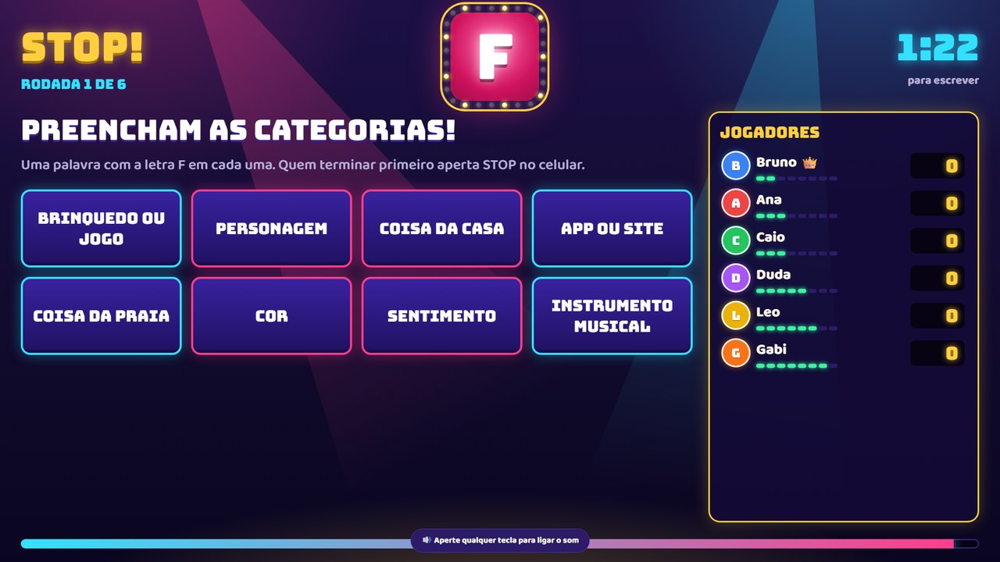
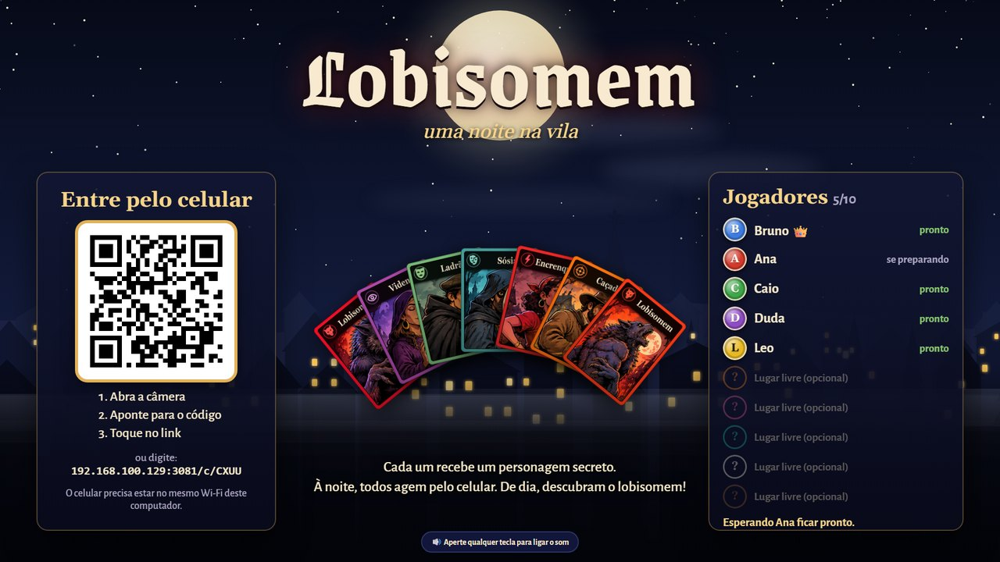
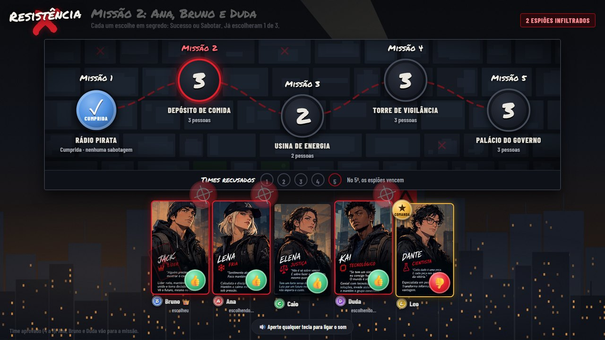
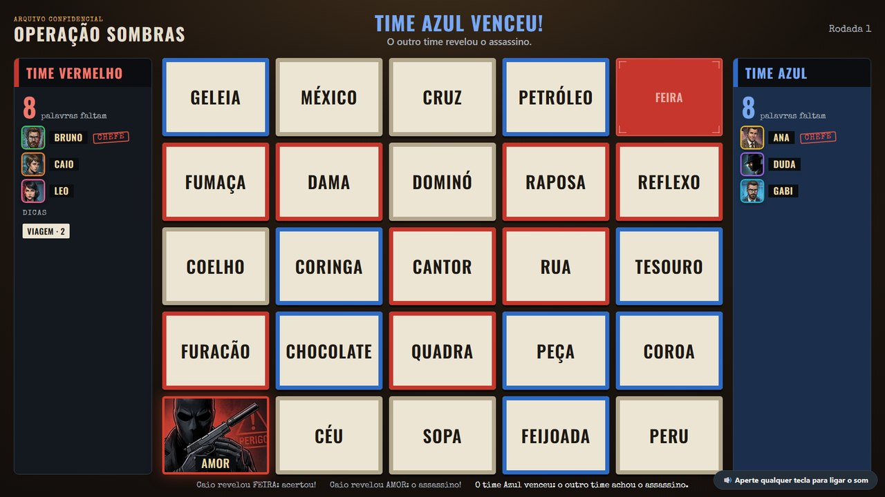
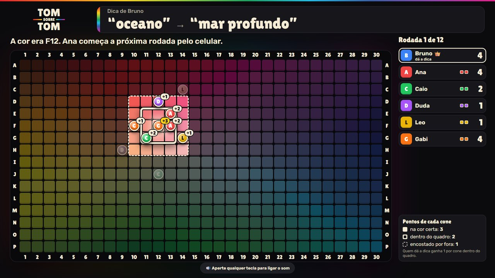
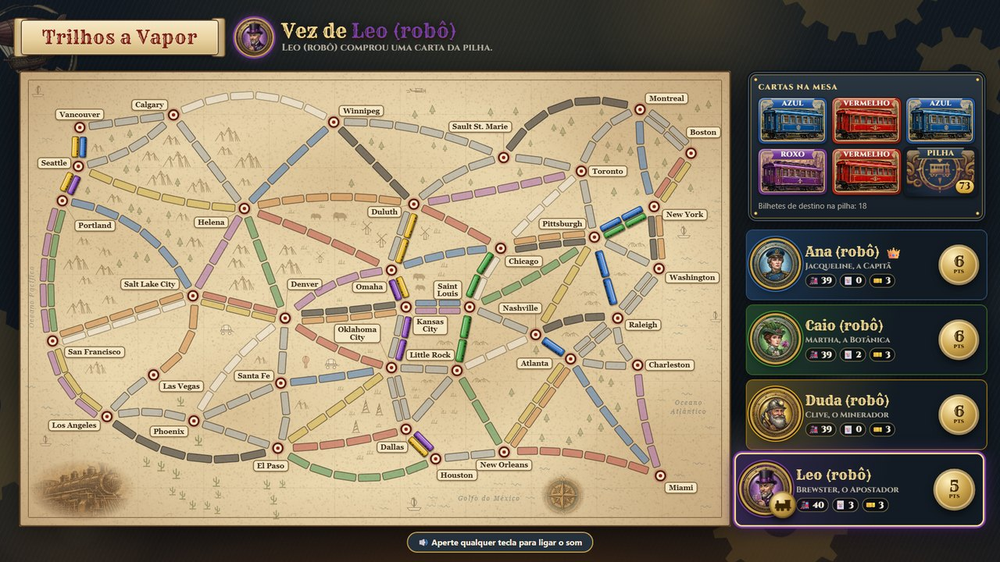

# Jogos na TV

Jogos de tabuleiro e de festa para jogar **na TV**, com o **celular de cada pessoa como
controle**. A TV mostra a mesa; o celular é a sua mão de cartas, o seu segredo e os seus
botões. Tudo pelo navegador: ninguém precisa instalar aplicativo no celular.

Grátis, para jogar em casa com a família e os amigos.

## Os jogos

### Stop!

A brincadeira de sempre, com cara de programa de auditório: a roleta sorteia a letra e cada
um escreve no celular uma palavra para cada categoria. Quem terminar primeiro aperta
**STOP!** e a turma confere as respostas na TV. **2 a 10 pessoas.**

### Lobisomem

Cada um recebe um personagem secreto no celular. À noite, todos agem ao mesmo tempo, em
segredo; de dia, conversem e descubram quem é o lobisomem. **3 a 10 pessoas.**

### Resistência

Jogo de papéis secretos numa cidade distópica: a Resistência monta equipes para as missões,
mas há espiões infiltrados entre vocês. **5 a 10 pessoas.**

### Operação Sombras

Dois times de espiões. O chefe de cada time vê no celular quais palavras são do seu time e dá
uma dica de uma palavra só; o time tenta acertar sem cair no assassino. **4 a 8 pessoas.**

### Tom Sobre Tom

Quem dá a dica vê uma cor secreta e dá uma dica de uma palavra ("tomate"); os outros tocam
no celular a cor que acham que é, num quadro de 480 cores. Depois vem uma segunda dica, de
até duas palavras. **3 a 10 pessoas.**

### Trilhos a Vapor

Junte cartas de vagão e ligue cidades pelo mapa dos Estados Unidos. As cartas e os bilhetes
de destino de cada um ficam no celular. **2 a 5 pessoas.**

## Como jogar

Você precisa de um computador (ligado na TV por um cabo HDMI, ou a própria tela dele) e de
um celular por pessoa, **todos no mesmo Wi-Fi**.

1. Instale o **Node.js** (versão "LTS") em [nodejs.org](https://nodejs.org). É grátis.
2. Baixe este projeto: botão verde **Code** → **Download ZIP**, e descompacte.
3. Entre na pasta `jogos`, abra a pasta do jogo e dê dois cliques em **`iniciar.bat`**.
   Na primeira vez ele baixa o que falta (precisa de internet). A tela da TV abre sozinha
   (no Chrome ou no Edge).
4. Se o Windows perguntar sobre o firewall, clique em **Permitir**.
5. Cada pessoa aponta a câmera do celular para o **QR code** da TV.
6. O primeiro a entrar é o **líder** 👑 e começa a partida pelo celular. A TV só mostra:
   não precisa de mouse.

Para ver um jogo funcionando sozinho, com ele ligado, dê dois cliques em
`testar-com-robos.bat`: robôs entram e jogam com você.

No Mac ou no Linux: abra o terminal na pasta do jogo, rode `npm install` e depois
`npm start`, e abra no navegador o endereço que aparecer.

Cada jogo usa uma porta própria, então dá para deixar vários ligados ao mesmo tempo:

| Jogo | Endereço da TV |
|---|---|
| Stop! | http://localhost:3090 |
| Lobisomem | http://localhost:3080 |
| Resistência | http://localhost:3040 |
| Operação Sombras | http://localhost:3030 |
| Tom Sobre Tom | http://localhost:3070 |
| Trilhos a Vapor | http://localhost:3000 |

Como se joga cada um: veja o `LEIA-ME.md` dentro da pasta do jogo.

## Quer ajudar?

Melhorias e jogos novos são muito bem-vindos! Abra uma *issue* para contar uma ideia ou um
problema, ou mande um *pull request* com a sua mudança.

Para criar um jogo novo, comece pela pasta `modelo`: a sala com QR code, o líder, a
reconexão e os testes já funcionam. Cada jogo é uma pasta independente, com a sua própria
cara (cores, fontes, personagens e sons).

## Licença

Livre para usar, mudar e compartilhar, inclusive em outros projetos, desde que o nome do
autor continue junto (licença MIT, no arquivo `LICENSE`). As artes dos personagens e das
cartas seguem a mesma ideia: podem ser usadas à vontade, dando o crédito a Bruno Lima
(licença [CC BY 4.0](https://creativecommons.org/licenses/by/4.0/deed.pt-br)).

## Aviso

Este é um projeto de fã, grátis e sem fins lucrativos, **sem nenhuma ligação com as
editoras** dos jogos que o inspiraram: Operação Sombras é inspirado no Codenames, Tom Sobre
Tom no Hues and Cues, Trilhos a Vapor no Ticket to Ride, Lobisomem no One Night Ultimate
Werewolf e Resistência no The Resistance. Esses nomes são marcas dos seus donos.

As regras de um jogo não têm dono; os desenhos, as artes dos personagens, os sons e os textos
daqui foram feitos para este projeto. Se você representa alguma dessas editoras e quer que
algo seja mudado ou retirado, abra uma *issue* e a gente resolve.

## Créditos

- Criado por **Bruno Lima**: a ideia, as artes dos personagens e a aprovação de cada tela.
- Programado com a ajuda do Claude, a IA da Anthropic.
- Fontes: Google Fonts (a licença de cada uma está junto dela, em `public/fonts/`).
- Sons: criados na hora pelo próprio navegador; não há arquivos de som.
